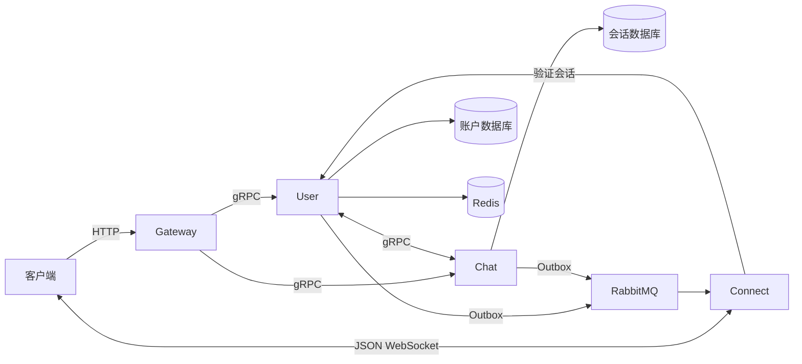

# IM Core

一个基于 Go 和 Kratos 的基础即时通讯后端，提供账户、好友、文字私聊、群聊、JSON WebSocket 投递和离线同步。

A minimal Go IM backend with direct/group messaging, JSON WebSocket delivery, and offline synchronization. Built with Kratos, MySQL, Redis, RabbitMQ, and Consul.

项目适合学习 IM 消息链路、验证客户端接入和作为后端开发起点。目前提供后端源码及集成测试，没有配套前端。

## 功能

| 模块 | 能力 |
|---|---|
| 账户 | 注册、密码登录、资料修改、密码修改、会话刷新与注销 |
| 好友 | 申请、接受、拒绝、取消、备注、删除、拉黑与解除 |
| 消息 | 文字私聊和群聊、发送幂等、历史补拉、撤回、已读进度 |
| 群组 | 建群、邀请、开放或审批入群、成员查询、改名、退出、移除与解散 |
| 同步 | JSON 长连接、心跳、在线投递、消息及事件离线补拉 |

基础规则：

- 每个账户只有一个有效登录会话；使用同一有效 Token 可以建立多个长连接。
- 私聊发送要求双方保持好友且任一方未拉黑。
- 群主需要解散群，基础版不提供群主转让。
- 新加入或重新加入的群成员，只能读取本次加入后的消息。
- 头像只保存 URL，不提供文件上传；用户消息只支持文字。

## 架构



| 服务 | 路径 | 职责 |
|---|---|---|
| Gateway | `app/gateway` | v2 HTTP 入口、请求解析和身份验证 |
| User | `app/user/service` | 账户、有效会话、好友关系与好友事件 |
| Chat | `app/chat/service` | 会话、群资料、消息、已读与会话事件 |
| Connect | `app/connect/service` | 长连接管理和指定用户投递 |

Consul 提供服务注册发现。User 和 Chat 使用独立数据库；会话和群资料分表，私聊双方具有唯一键，系统事件不会占用文字消息序号。

公开契约位于 [Proto](api/im/v2/im.proto)，初始化迁移位于 `docs/sql/`。内部认证和私聊创建 RPC 不提供公开 HTTP 路由。

## 快速启动

需要 Go 1.26 和 Docker Compose。获取源码并启动：

```sh
git clone https://github.com/hellokitty980808-ctrl/im-core.git
cd im-core
make init-local
make up
```

初始化生成随机数据库、缓存、MQ 密码及 RSA JWT 密钥，保存到权限 0600 的 `.env`，不会覆盖已有文件。服务自动创建数据库并执行迁移；已执行迁移的校验和改变会阻止启动。

| 入口 | 本地地址 |
|---|---|
| HTTP | `http://127.0.0.1:18000` |
| WebSocket | `ws://127.0.0.1:16200/v2/ws` |
| 存活检查 | `GET http://127.0.0.1:18000/healthz` |

存活检查通过不代表完整依赖链路可用；可通过下面的业务请求或 E2E 验证。

```sh
make logs
make down
```

停止环境保留数据卷。修改基础设施密码时，需要同时处理已有数据卷中的凭据。

## 接入示例

以下使用 HTTP 标准 JSON。ID、序号和游标编码为字符串，时间统一 Unix 毫秒。成功响应直接返回对象，失败由 HTTP 状态及 `error.code/error.message` 表示。

### 1. 获取验证码并注册

```sh
curl http://127.0.0.1:18000/v2/captcha
```

响应包含 `captchaId` 和图片 `image`。读取图片中的验证码后发送注册请求，示例中的 ID、验证码和密码均需替换：

```sh
curl -X POST http://127.0.0.1:18000/v2/accounts \
  -H 'Content-Type: application/json' \
  -d '{"account":"alice_01","nickname":"Alice","password":"your-local-password","captchaId":"your-captcha-id","captchaCode":"your-input"}'
```

账号为 3–32 位字母、数字和下划线，统一转小写；密码为 8–72 字节；昵称为 2–32 个字符。注册成功返回用户资料、`token` 和 `expiresAt`。

后续登录使用 `POST /v2/sessions`，传 `account/password/captchaId/captchaCode`。受保护接口均使用 `Authorization: Bearer <token>`。

### 2. 建立好友与私聊

先搜索另一账户，取得其 `userId`：

```sh
curl 'http://127.0.0.1:18000/v2/users?account=bob_01' \
  -H 'Authorization: Bearer ALICE_TOKEN'
```

Alice 发送好友申请，Bob 使用自己的 Token 接受：

```sh
curl -X POST http://127.0.0.1:18000/v2/friend-requests \
  -H 'Authorization: Bearer ALICE_TOKEN' \
  -H 'Content-Type: application/json' \
  -d '{"userId":"BOB_USER_ID","note":"你好"}'

curl -X POST http://127.0.0.1:18000/v2/friend-requests/REQUEST_ID/accept \
  -H 'Authorization: Bearer BOB_TOKEN' \
  -H 'Content-Type: application/json' \
  -d '{}'
```

将示例的用户 ID、申请 ID 和 Token 替换为实际响应值。接受成功返回 `conversationId`；恢复好友会复用原私聊。

### 3. 建立长连接并发送文字

要观察在线投递，Bob 先连接 WebSocket 地址，在五秒内发送认证文本帧：

```json
{"version":2,"type":"auth","requestId":"auth-1","data":{"token":"BOB_TOKEN"}}
```

收到 `type:ready` 后，Alice 再发送文字：

```sh
curl -X POST http://127.0.0.1:18000/v2/conversations/CONVERSATION_ID/messages \
  -H 'Authorization: Bearer ALICE_TOKEN' \
  -H 'Content-Type: application/json' \
  -d '{"content":"你好","idempotencyKey":"message-001"}'
```

Bob 的连接将接收 `type:message`；状态变化以 `type:event` 推送。客户端建议每 20 秒发送 `type:ping`，服务端返回 `type:pong`。消息发送仍通过 HTTP 完成。

文字最多 2048 字节；发送键为 1–64 个可见 ASCII 字符。同一发送的重试复用原键，不同消息使用不同键；同一账户下改变会话或内容后复用键，返回 409。

### 4. 断线后恢复

```sh
curl 'http://127.0.0.1:18000/v2/conversations/CONVERSATION_ID/messages?afterSeq=0&limit=30' \
  -H 'Authorization: Bearer BOB_TOKEN'

curl 'http://127.0.0.1:18000/v2/conversation-events?cursor=0&limit=30' \
  -H 'Authorization: Bearer BOB_TOKEN'
```

先读取会话列表确认成员状态，再分别补拉消息、好友事件和会话事件。使用响应中的 `nextSeq/nextCursor` 继续分页；事件处理完成后再调用相应的 `/ack` 接口。

在线投递和补拉允许重复：消息按消息 ID 去重，事件按事件流和游标去重。两个事件流的游标不能混用。

完整协议见 [API](docs/API.md)、[OpenAPI](docs/openapi.yaml) 和 [WebSocket](docs/WEBSOCKET.md)。

## 持久化与运行边界

消息、发送键和 Outbox 在同一事务提交。队列确认发布后标记 Outbox 已发布，失败保留并重试；慢连接关闭后通过历史和事件补拉恢复。在线投递至少一次，不承诺恰好一次。

示例 Compose 只绑定本机回环地址，基础设施不发布宿主机端口。公开部署需要 HTTPS/WSS，内部 RPC 和基础设施应位于受控网络。

浏览器 Origin 默认必须与长连接地址同源；通过 `WS_ALLOWED_ORIGINS` 设置允许的完整 Origin，多个值用逗号分隔。普通无 Origin 的客户端可直接连接。

尚未验证生产环境、跨主机多实例、压力容量、真实客户端 UI 和 HTTPS/WSS 部署，不提供相应性能保证。

## 开发与测试

```sh
make test
make vet
make build
make audit
```

普通测试显式跳过真实四服务 E2E 和 MySQL 事件排序测试。真实环境测试仅用于隔离的本地 Compose，会创建随机前缀的账户和消息，并保留数据便于检查：

```sh
CAPTCHA_DISABLED=true docker compose up -d --no-build
make e2e
# 可选：测试会真实停启本地 RabbitMQ
IMCORE_FAULTS=1 make e2e
# 测试结束后恢复验证码；如果测试失败也需要执行
CAPTCHA_DISABLED=false docker compose up -d --no-build
```

已有验证覆盖基础 IM、权限、并发幂等、离线同步和队列停机恢复，见 [验证记录](docs/VERIFICATION.md)。`make audit` 是明显凭据规则扫描，不等于完整安全审计。

修改协议需要已安装 `protoc`：

```sh
make tools
make generate
```

RPC、HTTP、配置、OpenAPI 和 Wire 均从源生成。数据库变更新增迁移，不修改已执行文件。开发约定见 [贡献指南](CONTRIBUTING.md)。

## 许可证

项目采用 [MIT](LICENSE)。第三方依赖和标准协议保留各自的许可及版权，见 [第三方说明](THIRD_PARTY_NOTICES.md)。

首版发布说明见 [首版说明](docs/RELEASE_NOTES.md)。
